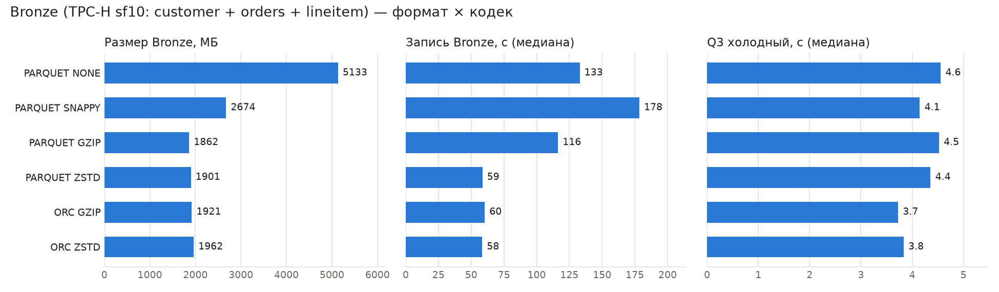

# Отчёт по практической №1 — Lakehouse и медальон для TPC-H Q3

Все цифры ниже — из реальных прогонов на моей машине (Windows 11, Docker Desktop: VM 8 ГБ RAM / 16 vCPU). Сырые результаты лежат в [results/](results/), каждый шаг воспроизводится скриптами из [scripts/](scripts/) (см. [README.md](README.md)).

---

## 1. Вариант и масштаб

| Поле | Значение |
|---|---|
| ФИО (как в VK Education) | Бубнов Дмитрий Павлович |
| Вариант (запрос) | **Q3** «Shipping Priority» (вариант 1) |
| Масштаб `sfN` | **sf10** |
| Почему выбрал такой масштаб | **sf10** — это 60 млн строк `lineitem`, 15 млн `orders`, 1,5 млн `customer`. Bronze на диске весит 1,9 ГБ (ZSTD) – 5,1 ГБ (без сжатия). **sf1** мал: весь Bronze (~250 МБ) лежит в page cache, Q3 идёт доли секунды, и разница между кодеками тонет в шуме. **sf100** не помещается в ресурсы: VM Docker — 8 ГБ RAM (джойн orders × lineitem упёрся бы в память), а 6 конфигураций бенчмарка — это ~200 ГБ при 145 ГБ свободных. sf10 — максимум, который честно помещается в RAM и на диск, и при этом даёт измеримую разницу в размере и времени записи. |

## 2. Поднятые сервисы — и почему именно они

`docker ps` ([results/docker_ps.txt](results/docker_ps.txt)):

```
NAMES           IMAGE                                    STATUS                 PORTS
trino           trinodb/trino:476                        Up (healthy)           0.0.0.0:8080->8080/tcp
lh-lakekeeper   quay.io/lakekeeper/catalog:latest-main   Up                     0.0.0.0:8181->8181/tcp
lh-postgres     postgres:17                              Up (healthy)           5432/tcp
lh-minio        pgsty/silo:latest                        Up                     0.0.0.0:9000-9001->9000-9001/tcp
```
(+ одноразовые `lh-minio-init`, `lh-lakekeeper-migrate`; `apache/spark:3.5.3` запускается по требованию, см. §6.2)

| Сервис | Роль в стеке | Почему именно он (а не альтернатива) |
|---|---|---|
| MinIO → **Silo** (`pgsty/silo`) | S3-совместимое объектное хранилище (сюда физически падают parquet-файлы) | Даёт тот же S3 API, что AWS S3, поэтому код и конфиги переносятся в облако без изменений. Хранение отделено от вычислений: движки можно менять, данные остаются на месте. Образы MinIO в 2026 закрыты (`quay.io/minio/*` отвечает 401, AIStor требует лицензию), поэтому взят **Silo** — открытый форк MinIO с тем же API, портами и переменными. Альтернативы: Ceph RGW тяжёл для ноутбука, локальная ФС не даёт S3-семантики, которую ждут Trino и Spark. |
| PostgreSQL 17 | БД, где Lakekeeper хранит метаданные каталога | Lakekeeper умеет работать только с Postgres. Каталог — это транзакционный указатель «таблица → текущий metadata.json», и коммит снапшота должен быть атомарным; Postgres это гарантирует (ACID, row-level locks). Зрелый, бесплатный, ставится одним образом. |
| Lakekeeper | Iceberg REST Catalog — каталог метаданных таблиц | Реализует **стандартный Iceberg REST API**, поэтому к одним и тем же таблицам подключаются и Trino, и Spark (проверено в §6.2). Написан на Rust: один лёгкий контейнер, есть UI, warehouse регистрируются через API. Альтернативы: Hive Metastore тяжелее (JVM + Thrift) и не знает об Iceberg-снапшотах; Nessie хорош для git-подобного ветвления, но мне не нужен; AWS Glue — только облако. |
| Trino 476 | SQL-движок: ходит в Lakekeeper за метаданными и читает/пишет данные в MinIO | MPP-движок для интерактивной аналитики: старт за секунды, джойны в памяти. Есть встроенный коннектор **`tpch`** — данные генерируются прямо в `CREATE TABLE AS SELECT`, ничего не надо скачивать. Iceberg-коннектор поддерживает всё, что нужно в работе: партиционирование, `compression_codec`, системные таблицы `$files`/`$snapshots`, time travel, `rollback_to_snapshot`, schema evolution. На Q3 он в ~11 раз быстрее Spark (4,4 с против 49 с, §6.2). |
| Apache Spark 3.5.3 | второй движок поверх Bronze (часть 2) | Нужен, чтобы показать открытость формата: читает те же файлы через тот же каталог без Trino. Обоснование выбора — в §6.2. |

> Вместо отдельных `docker run` из гайда стек описан одним **docker-compose.yml**. Сервисы общаются по DNS-именам внутренней сети (`lh-minio`, `lh-lakekeeper`) вместо `host.docker.internal`, порядок старта задан через `depends_on` (Postgres healthy → migrate → serve), а весь стек поднимается и удаляется одной командой.

### Скрипты, которыми поднимал стек

Полный файл — [docker-compose.yml](docker-compose.yml), инициализация каталога — [scripts/01_init_catalog.sh](scripts/01_init_catalog.sh).

```bash
docker compose up -d                 # весь стек:
#   lh-minio          pgsty/silo  server /data --console-address :9001   -> S3 API :9000, консоль :9001, том p1-minio-data
#   lh-minio-init     pgsty/mc    mc mb bronze silver gold              -> по бакету на слой медальона
#   lh-postgres       postgres:17 (healthcheck pg_isready)              -> метаданные Lakekeeper, том p1-pg-data
#   lh-lakekeeper-migrate  lakekeeper migrate                           -> схема БД каталога (одноразово)
#   lh-lakekeeper     lakekeeper serve                                  -> Iceberg REST :8181
#   trino             trinodb/trino:476 + ./catalog + trino/config.properties -> SQL :8080

bash scripts/01_init_catalog.sh      # POST /management/v1/bootstrap (Terms of Use)
                                     # POST /management/v1/warehouse  x3: bronze/silver/gold -> бакеты bronze/silver/gold
```

Каталоги Trino ([catalog/](catalog/)): `bronze.properties`, `silver.properties`, `gold.properties` (Iceberg REST → свой warehouse) и `tpch.properties` (`connector.name=tpch`).

Одно отличие от дефолта — [trino/config.properties](trino/config.properties): `query.max-memory-per-node=3.5GB`. По умолчанию это 30% кучи, около 1,8 ГБ, и эталонный Q3 по генератору `tpch.sf10` падал с `Query exceeded per-node memory limit of 1.83GB` (у генератора нет статистики, и Trino строил хеш-таблицу по большой стороне джойна). Куча Trino — около 6,1 ГБ (80% от 8 ГБ VM), headroom около 1,8 ГБ, так что 3,5 ГБ на запрос — безопасный предел.

## 3. Разбор запроса — какие данные нужны

| Таблица TPC-H | Нужные колонки | Что запрос с ними делает (фильтр / джойн / агрегат / вывод) |
|---|---|---|
| `customer` | `custkey`, `mktsegment` | фильтр `mktsegment = 'BUILDING'` (отсекает 80% клиентов); `custkey` — ключ джойна с `orders` |
| `orders` | `orderkey`, `custkey`, `orderdate`, `shippriority` | фильтр `orderdate < 1995-03-15`; `custkey` — джойн с `customer`, `orderkey` — с `lineitem`; `orderdate` и `shippriority` идут в GROUP BY и в вывод |
| `lineitem` | `orderkey`, `shipdate`, `extendedprice`, `discount` | фильтр `shipdate > 1995-03-15`; `orderkey` — джойн и ключ группировки; `sum(extendedprice * (1 - discount))` — агрегат `revenue`, по нему ORDER BY … LIMIT 10 |

Итого запросу нужны **4 колонки из 16** у `lineitem`, 4 из 9 у `orders`, 2 из 8 у `customer`. Поэтому колоночный формат здесь сильно выигрывает (см. §4, «Как Q3 читает Bronze»).

## 4. Медальон — решения по каждому слою

```
tpch.sf10 (генератор) ──CTAS──► BRONZE (бакет bronze)       ──► SILVER (бакет silver)             ──► GOLD (бакет gold)
                                 customer / orders / lineitem     dim_customer + fct_order_lines         q3_shipping_priority
                                 как есть + _loaded_at/_source    очистка, нормализация, обогащение,     топ-10 по выручке
                                                                  джойн, фильтр окна Q3
```

SQL слоёв: [sql/10_bronze.sql](sql/10_bronze.sql), [sql/20_silver.sql](sql/20_silver.sql), [sql/30_gold.sql](sql/30_gold.sql). Строки и размер — из системной таблицы Iceberg `$files` ([sql/50_layer_stats.sql](sql/50_layer_stats.sql) → [results/layer_stats.txt](results/layer_stats.txt)).

Время построения (sf10): Bronze — 4 мин 22 с (из них ~4 мин — `lineitem`), Silver — 20,5 с, Gold — 3,1 с.

### Bronze (сырой)

| Таблица | Колонки (что оставил) | Строк | Вес, МБ | Формат | Сжатие | Партиционирование | Обоснование |
|---|---|---|---|---|---|---|---|
| `customer` | все 8 + `_loaded_at`, `_source` | 1 500 000 | 78,0 | PARQUET | ZSTD | нет | Bronze = сырые данные «как пришли»: беру **все** колонки, чтобы слой годился и для других запросов (Q10, Q18) и не требовал перезагрузки из источника. Технические `_loaded_at`/`_source` нужны для дедупликации в Silver и для аудита. Партиций нет: 78 МБ — это и так 3 файла, разбиение дало бы мелкие файлы и лишние манифесты. |
| `orders` | все 9 + `_loaded_at`, `_source` | 15 000 000 | 365,7 | PARQUET | ZSTD | `year(orderdate)` → 7 партиций | Q3 фильтрует `orderdate < 1995-03-15`. С партициями по году Trino не открывает 1996–1998: прочитано **9,1 млн строк из 15 млн** (4 сплита из 8). Год, а не месяц: партиция ~55 МБ — нормальный размер файла; по месяцам вышло бы 84 файла по ~4 МБ. |
| `lineitem` | все 16 + `_loaded_at`, `_source` | 59 986 052 | 1 453,0 | PARQUET | ZSTD | `year(shipdate)` → 7 партиций | Q3 фильтрует `shipdate > 1995-03-15`, поэтому 1992–1994 отсекаются целиком: прочитано **34,2 млн строк из 60 млн**. Партиция ~220 МБ — близко к оптимальному для Parquet размеру файла (128–512 МБ). |

**Формат и кодек Bronze.** Parquet, потому что это стандарт экосистемы (Trino, Spark, pandas и DuckDB читают его без конвертации) и дефолт Iceberg. ZSTD — по результатам бенчмарка (§5): сжимает в 2,7 раза против NONE, почти как GZIP (разница 2%), но пишет вдвое быстрее GZIP и стабильнее всех кодеков. Bronze — самый большой слой, который пишется при каждой загрузке, поэтому для него важны и размер, и скорость записи.

**Как Q3 читает Bronze** (`EXPLAIN ANALYZE`, [results/q3_explain_analyze_bronze.txt](results/q3_explain_analyze_bronze.txt)):

| Таблица | Лежит на диске | Physical input Q3 | Почему так мало |
|---|---|---|---|
| lineitem | 1 453 МБ | **210 МБ** (14%) | партиции 1995–1998 + из 18 колонок читаются 4 |
| orders | 366 МБ | **49 МБ** (13%) | партиции 1992–1995 + 4 колонки из 11 |
| customer | 78 МБ | **2,2 МБ** (3%) | 2 колонки из 10 — `comment`/`address` не читаются вовсе |

### Silver (очищенный)

| Таблица | Колонки (что оставил) | Строк | Вес, МБ | Формат | Сжатие | Партиционирование | Обоснование |
|---|---|---|---|---|---|---|---|
| `dim_customer` | `custkey`, `name`, `nationkey`, `mktsegment`, `acctbal`, `_loaded_at` | 1 500 000 | 12,4 | PARQUET | ZSTD | нет | **Очистка и нормализация:** дедупликация по `custkey` (берётся последняя версия по `_loaded_at` через `row_number()`), `upper(trim(mktsegment))` — защита от `'building '` в сырых данных, `acctbal` → `decimal(12,2)`. Выброшены длинные текстовые `address`/`phone`/`comment` — они не нужны аналитике, поэтому таблица в 6 раз легче Bronze (12 МБ против 78). Справочник не привязан к Q3, его можно переиспользовать в других витринах. |
| `fct_order_lines` | `orderkey`, `linenumber`, `custkey`, `mktsegment`, `orderdate`, `shippriority`, `shipdate`, `ship_lag_days`, `extendedprice`, `discount`, `net_revenue` | 302 114 | 4,7 | PARQUET | ZSTD | нет | Факт «строки заказов»: джойн `lineitem ⋈ orders ⋈ dim_customer` и фильтр окна Q3 (BUILDING, даты). **Проверки качества:** `extendedprice > 0`, `discount BETWEEN 0 AND 1`, `shipdate >= orderdate`. **Обогащение:** `net_revenue = extendedprice × (1 − discount)` считается один раз здесь, а не в каждом отчёте; `ship_lag_days` — дни от заказа до отгрузки. Деньги переведены из `double` в `decimal`, чтобы суммы были точными. Партиций нет: 4,7 МБ — это один файл, партиции дали бы только накладные расходы. |

ZSTD на Silver: слой читается чаще, чем пишется, а ZSTD декодируется быстро (в бенчмарке тёплый Q3 на ZSTD самый быстрый, 1,35 с). При этом Silver хранит историю снапшотов, и сжатие экономит место на каждой версии.

### Gold (витрина)

| Таблица | Колонки | Строк | Вес, МБ | Формат | Сжатие | Партиционирование | Обоснование |
|---|---|---|---|---|---|---|---|
| `q3_shipping_priority` | `revenue_rank`, `orderkey`, `revenue`, `orderdate`, `shippriority` | 10 | 0,001 (1 001 байт) | PARQUET | SNAPPY | нет | Готовый ответ на Q3: агрегат `sum(net_revenue)` по заказу, топ-10. Добавлен `revenue_rank`, чтобы BI не пересчитывал сортировку. На 10 строках степень сжатия ни на что не влияет, поэтому взят SNAPPY — дефолт Parquet, который понимает любой потребитель, включая старые BI-драйверы. Партиции на 10 строках бессмысленны. Чтение витрины — **0,19 с** против ~4,4 с у Q3 по Bronze. |

**Проверка корректности** ([sql/40_validate.sql](sql/40_validate.sql)): Gold сравнивается с эталонным Q3, посчитанным напрямую по генератору `tpch.sf10`. Обе разности (`эталон EXCEPT gold` и `gold EXCEPT эталон`) дают **0 строк** — витрина совпадает с эталоном до 4-го знака. Spark по Bronze вернул те же 10 заказов (§6.2).

Результат (топ-3 из 10):

| revenue_rank | orderkey | revenue | orderdate | shippriority |
|---|---|---|---|---|
| 1 | 4791171 | 440715.2185 | 1995-02-23 | 0 |
| 2 | 46678469 | 439855.3250 | 1995-01-27 | 0 |
| 3 | 23906758 | 432728.5737 | 1995-03-14 | 0 |

## 5. Тесты производительности

**Методика** ([scripts/05_benchmark.sh](scripts/05_benchmark.sh)):

1. Bronze целиком (`customer` + `orders` + `lineitem`, sf10, та же схема партиций) пересоздаётся в отдельной схеме `bronze.bench_<формат>_<кодек>` через `SET SESSION bronze.compression_codec` + CTAS.
2. Размер — `sum(file_size_in_bytes)` из `$files`. Время записи и запроса — `date_diff(started, end)` из `system.runtime.queries`, то есть чистое время исполнения без старта CLI.
3. **Холодный** Q3 запускается после `docker restart trino lh-minio` **и** `echo 3 > /proc/sys/vm/drop_caches` в VM Docker. Одного перезапуска MinIO мало: page cache живёт в ядре VM, а не в контейнере. Затем три **тёплых** прогона.
4. Parquet × {NONE, SNAPPY, GZIP, ZSTD} прогнан **3 раза**, в таблице — медиана (и разброс). ORC × {GZIP, ZSTD} — 1 раз, для сравнения форматов.

Сырые данные: [results/benchmark*.csv](results/), сводка — [results/summary.md](results/summary.md), график — [results/benchmark.png](results/benchmark.png).

| Сжатие на Bronze | Время запроса | Размер Bronze, МБ | Твой вывод (что лучше и почему) |
|---|---|---|---|
| GZIP | cold **4,52 с** (3,94–4,63), warm **1,51 с**; запись Bronze **116 с** (84–120) | **1 862** | Самый компактный (в 2,76 раза меньше NONE), но всего на **2% меньше ZSTD**. Платить за эти 39 МБ приходится **вдвое более долгой записью** (116 с против 58) — deflate тратит много CPU. Чтение не быстрее ZSTD. Оправдан только для холодного архива, который пишется один раз и почти не читается. |
| ZSTD | cold **4,36 с** (4,01–4,44), warm **1,35 с** — лучший; запись Bronze **58,5 с** (54–74) — лучшая и самая стабильная | **1 901** | **Выбран для Bronze.** Сжатие в 2,70 раза против NONE, то есть −63% места, а запись — самая быстрая среди Parquet. Декодирование ZSTD быстрое, поэтому тёплый Q3 на нём самый быстрый. На sf10 разница холодного Q3 между кодеками (4,0–4,6 с) — в пределах шума: Q3 читает с диска только ~260 МБ из-за проекции колонок и партиций. Решающими остаются размер и запись, и по сумме ZSTD выигрывает. |

Полная таблица (медиана из 3 прогонов для Parquet):

| Конфигурация | Прогонов | Bronze, МБ | lineitem, МБ | Сжатие vs NONE | Запись, с (медиана; мин–макс) | Q3 cold, с (медиана; мин–макс) | Q3 warm, с |
|---|---|---|---|---|---|---|---|
| PARQUET NONE | 3 | 5 133 | 3 756 | ×1,00 | 132,9 (73,0–176,8) | 4,56 (4,39–7,54) | 1,59 |
| PARQUET SNAPPY | 3 | 2 674 | 2 014 | ×1,92 | 178,4 (47,0–236,6) | 4,15 (4,07–4,48) | 1,48 |
| PARQUET GZIP | 3 | 1 862 | 1 434 | ×2,76 | 116,3 (83,7–119,5) | 4,52 (3,94–4,63) | 1,51 |
| **PARQUET ZSTD** | 3 | 1 901 | 1 458 | ×2,70 | **58,5** (54,3–74,1) | 4,36 (4,01–4,44) | **1,35** |
| ORC GZIP | 1 | 1 921 | 1 507 | ×2,67 | 60,3 | 3,73 | 1,34 |
| ORC ZSTD | 1 | 1 962 | 1 542 | ×2,62 | 58,4 | 3,83 | 1,43 |



**Что ещё видно из замеров:**

- **NONE и SNAPPY пишутся не быстрее, а медленнее и нестабильнее.** Запись `lineitem` в SNAPPY заняла от 35 до 222 с, в NONE — от 36 до 160 с. Эти кодеки выдают в 1,4–2,7 раза больше байт, а запись упирается в диск VM Docker (виртуальный диск на хосте). Значит, на этом железе узкое место — I/O, а не CPU, и сильное быстрое сжатие (ZSTD) **ускоряет** запись. GZIP стабилен, но медленен уже из-за CPU.
- **Холодный и тёплый прогоны.** Тёплый Q3 в ~3 раза быстрее холодного (1,3–1,6 с против 4,0–4,6 с): данные в page cache, метаданные Iceberg в кэше Trino. Без сброса кэша сравнение кодеков было бы нечестным: у всех вышло бы ~1,4 с.
- **Parquet и ORC.** На плоских таблицах TPC-H они сопоставимы: ORC на ~3% больше по размеру (1 921 против 1 862 МБ на GZIP, 1 962 против 1 901 на ZSTD), а холодный Q3 у ORC на 0,5–0,8 с быстрее (1 прогон, на грани шума). Остался на Parquet ради совместимости: Spark, pandas, DuckDB и BI-инструменты читают его без оговорок.
- **Выброс:** один тёплый прогон NONE дал 8,7 с (вероятно, GC или конкуренция за диск). Именно поэтому замеры повторялись трижды, а в таблице стоит медиана.

## 6. Часть 2 — осмысление и работа с инструментами

### 6.1. Понять и объяснить

| Вопрос | Твой ответ  |
|---|---|
| Зачем нужны большие данные и lakehouse (а не обычная БД/хранилище)? | Обычная OLTP-БД (Postgres) хранит данные построчно на одном сервере, и хранение с вычислениями в ней связаны. Сканы на десятки–сотни ГБ медленные, масштабироваться можно только «вверх», и хранить всё дорого. Классический DWH (Greenplum, Vertica, Snowflake) решает аналитику, но держит данные в своём закрытом формате: любой другой движок (ML на Spark, Python) вынужден их выгружать. Data lake (файлы в S3) дешёв и открыт, но без транзакций, схемы и истории превращается в «болото». **Lakehouse объединяет оба подхода:** данные лежат дёшево в объектном хранилище в открытом формате (Parquet), а табличный формат Iceberg добавляет ACID-коммиты, схему и её эволюцию, снапшоты и time travel, партиционирование и статистику. Хранение и вычисления разделены: в работе один Bronze читали Trino и Spark одновременно, без копирования. Хранение масштабируется независимо от движка: 5 ГБ сырых данных превратились в 1,9 ГБ на ZSTD, а Q3 прочитал с диска всего ~260 МБ. |
| Пример schema evolution на Silver: добавил/переименовал колонку — что произошло? | Скрипт [scripts/06_schema_evolution_time_travel.sh](scripts/06_schema_evolution_time_travel.sh), лог — [results/schema_evolution_time_travel.log](results/schema_evolution_time_travel.log). На `silver.lakehouse.fct_order_lines` (302 114 строк, 1 файл): **1)** `ALTER TABLE … ADD COLUMN gross_revenue decimal(18,4)` выполнился мгновенно. Файлы данных **не переписывались** (их по-прежнему 1), для старых строк колонка читается как NULL (`count(gross_revenue) = 0`): Iceberg просто записал новую версию схемы в metadata.json. **2)** `UPDATE … SET gross_revenue = extendedprice` создал новый снапшот (`overwrite`). Проверка: `sum(gross_revenue) − sum(net_revenue)` = 577 717 722,68 — это сумма скидок. **3)** `ALTER TABLE … RENAME COLUMN ship_lag_days TO days_to_ship` тоже прошёл без перезаписи файлов: Iceberg связывает колонки с файлами по **field-id**, а не по имени, поэтому в parquet-файлах колонка осталась `ship_lag_days`, а читается как `days_to_ship`. **4)** `SELECT * … FOR VERSION AS OF <снапшот до изменений>` возвращает данные в **старой схеме** (`ship_lag_days`, без `gross_revenue`): каждый снапшот помнит свою схему. ADD и RENAME снапшотов не создают (они меняют только метаданные), UPDATE создаёт. Gold после этих изменений продолжает работать, потому что читает только `net_revenue` и ключи. |
| Пример скрипта восстановления данных из снапшота (time travel) | См. скрипт ниже. Сценарий «авария»: случайный `DELETE` всех заказов 1995 года оставил **47 080 строк из 302 114** (выручка упала с 10,98 млрд до 1,71 млрд). Через `FOR VERSION AS OF` и `FOR TIMESTAMP AS OF` видны все 302 114 строк. `ALTER TABLE … EXECUTE rollback_to_snapshot(id)` вернул указатель таблицы на хороший снапшот: снова 302 114 строк и 10 975 761 617,91. Данные не копировались, откат занял доли секунды: файлы старого снапшота никуда не делись. В `$history` у ошибочного `delete` стоит `is_current_ancestor = false` — он выпал из линии таблицы. |

Скрипт восстановления (Trino SQL, полный вариант — в [scripts/06_schema_evolution_time_travel.sh](scripts/06_schema_evolution_time_travel.sh)):

```sql
-- 1. Найти последний хороший снапшот (до аварии)
SELECT snapshot_id, committed_at, operation
FROM silver.lakehouse."fct_order_lines$snapshots"
ORDER BY committed_at DESC;
--   8706057299756576312 | 2026-10-17 15:45:39.314 UTC | overwrite   <- хороший
--   5904699837544924034 | 2026-10-17 15:45:49.987 UTC | delete      <- ошибочный DELETE

-- 2. Убедиться, что в нём правильные данные (time travel, таблица не меняется)
SELECT count(*), sum(net_revenue)
FROM silver.lakehouse.fct_order_lines FOR VERSION AS OF 8706057299756576312;          -- 302114 | 10975761617.9122
SELECT count(*)
FROM silver.lakehouse.fct_order_lines FOR TIMESTAMP AS OF TIMESTAMP '2026-10-17 15:45:39.314 UTC';  -- 302114

-- 3a. Восстановить: откатить текущее состояние таблицы на этот снапшот
ALTER TABLE silver.lakehouse.fct_order_lines EXECUTE rollback_to_snapshot(8706057299756576312);

-- 3b. (альтернатива, если нужно восстановить в отдельную таблицу и сверить)
-- CREATE TABLE silver.lakehouse.fct_order_lines_restored AS
-- SELECT * FROM silver.lakehouse.fct_order_lines FOR VERSION AS OF 8706057299756576312;

-- 4. Проверка
SELECT count(*), sum(net_revenue) FROM silver.lakehouse.fct_order_lines;               -- 302114 | 10975761617.9122
```

### 6.2. Подключить инструмент к lakehouse

| Инструмент | Почему выбрал именно его |
|---|---|
| **Apache Spark 3.5.3** (движок) + Iceberg runtime 1.7.1 | 1) **Проверка главного свойства lakehouse — открытости.** Spark подключается к тому же REST-каталогу Lakekeeper и тому же S3 и читает Bronze **без Trino**: на время прогона Trino был остановлен. Данные не заперты в одном движке. 2) **Сравнение движков на моём запросе.** Q3 по Bronze sf10: Spark — **49,3 с**, Trino — **4,4 с** (холодный). Для интерактивной аналитики над готовыми таблицами Trino лучше: MPP-конвейер в памяти без стадийного shuffle на диск и старт за секунды. Spark — batch-движок, он платит за старт JVM и SparkContext и пишет shuffle между стадиями, зато сильнее на тяжёлом ETL (отказоустойчивость стадий, spill, кластер из многих узлов, Python/ML). Для моей задачи Trino — основной движок, а Spark — кандидат для ETL Bronze → Silver при росте объёма до sf100+. Doris и StarRocks не выбрал: для Iceberg-таблиц они работают как внешний каталог с собственным кэшем и нужны, когда требуются миллисекундные дашборды. Superset и Metabase показали бы данные, но всё равно через Trino, а не напрямую через Iceberg. |

**Скрипт развёртывания** — [scripts/07_spark_bronze.sh](scripts/07_spark_bronze.sh) + [spark/conf/spark-defaults.conf](spark/conf/spark-defaults.conf) (jar'ы — [scripts/00_download_spark_jars.sh](scripts/00_download_spark_jars.sh)):

```bash
docker stop trino      # Trino не участвует: Spark работает с lakehouse сам
docker run --rm --name lh-spark --network lakehouse-p1_default \
  -v "$(pwd)/spark/conf:/opt/spark/conf" \
  -v "$(pwd)/spark/jars:/opt/spark/iceberg-jars" \
  apache/spark:3.5.3 /opt/spark/bin/spark-sql -e "<SQL ниже>"
```

```properties
# spark-defaults.conf — каталог bronze = Iceberg REST (Lakekeeper) + S3FileIO (Silo)
spark.sql.catalog.bronze                 org.apache.iceberg.spark.SparkCatalog
spark.sql.catalog.bronze.catalog-impl    org.apache.iceberg.rest.RESTCatalog
spark.sql.catalog.bronze.uri             http://lh-lakekeeper:8181/catalog
spark.sql.catalog.bronze.warehouse       bronze
spark.sql.catalog.bronze.io-impl         org.apache.iceberg.aws.s3.S3FileIO
spark.sql.catalog.bronze.s3.endpoint     http://lh-minio:9000
spark.sql.catalog.bronze.s3.path-style-access true
```

**Мои действия и что увидел** (лог — [results/spark_bronze.log](results/spark_bronze.log)):

| Действие в `spark-sql` | Результат |
|---|---|
| `SHOW NAMESPACES IN bronze; SHOW TABLES IN bronze.lakehouse;` | `lakehouse` → `customer`, `orders`, `lineitem` — те же таблицы, что создал Trino |
| `DESCRIBE TABLE bronze.lakehouse.lineitem` | 18 колонок (16 TPC-H + `_loaded_at`, `_source`), `# Partitioning: years(shipdate)` — Spark видит партиционирование, заданное в Trino |
| `count(*)` по трём таблицам | 1 500 000 / 15 000 000 / 59 986 052 — совпадает с Trino |
| `SELECT … FROM bronze.lakehouse.lineitem.snapshots` | снапшот `4595932919969407211`, `append`, `added-records = 59986052` — тот же id, что в Trino `$properties` |
| `SELECT … FROM bronze.lakehouse.lineitem.partitions` | 7 партиций `shipdate_year` 22…28 (1992…1998), по ~9,1 млн строк |
| Q3 по Bronze | тот же топ-10, что Gold (4791171 → 440715.2185, …), `Time taken: 49.308 seconds` |

## 7. Выводы

1. **Медальон** разделяет ответственность. Bronze хранит полную сырую копию, и любой слой выше можно пересобрать без источника (Silver и Gold пересобираются за ~24 с). Silver — единственное место, где живут правила очистки, нормализации и расчёта выручки, поэтому витрины не дублируют логику. Gold отвечает на бизнес-вопрос за 0,19 с вместо ~4,4 с у Q3 по Bronze. Корректность цепочки проверена: Gold совпадает с эталонным Q3 строка в строку.
2. **Хранение:** партиционирование по колонкам фильтра (`year(orderdate)`, `year(shipdate)`) вместе с колоночным Parquet привело к тому, что Q3 прочитал с диска ~260 МБ из 1,9 ГБ Bronze. Партиционировать маленькие таблицы (customer, Silver, Gold) не стал: это лишь плодит мелкие файлы.
3. **Сжатие:** ZSTD — лучший выбор по сумме метрик. Размер на 2% больше GZIP, но запись вдвое быстрее GZIP и в 2–3 раза быстрее «быстрых» NONE и SNAPPY, которые на этом железе упираются в диск. Скорость Q3 на sf10 от кодека почти не зависит (в пределах шума холодного прогона), потому что запрос читает мало байт. GZIP имеет смысл только для архива, NONE — никогда.
4. **Lakehouse против обычной БД:** формат Iceberg дал schema evolution без перезаписи файлов, мгновенный откат ошибочного DELETE через снапшоты и чтение одних и тех же данных двумя движками (Trino, Spark) без копирования. Для моей интерактивной задачи Trino в ~11 раз быстрее Spark.
